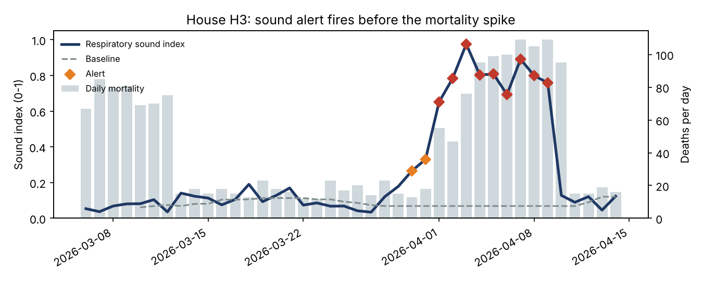
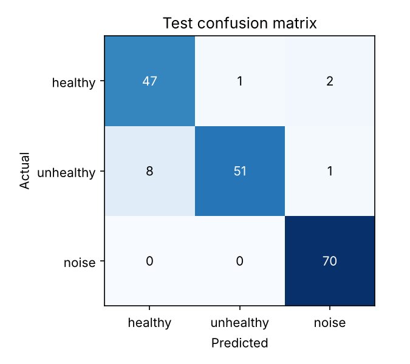
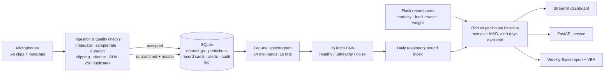
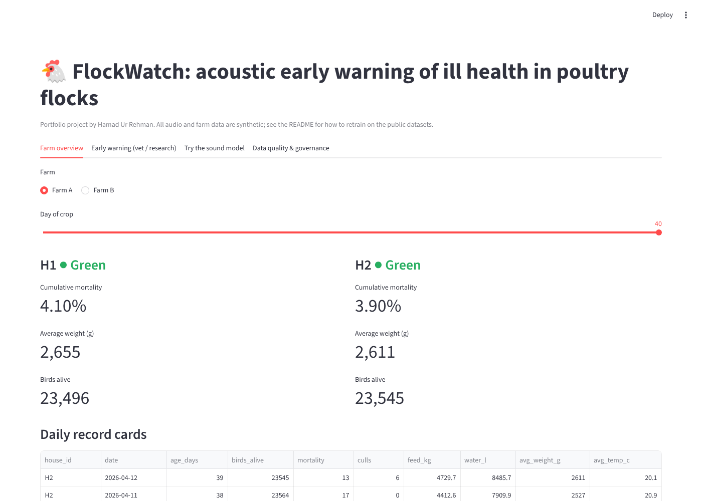
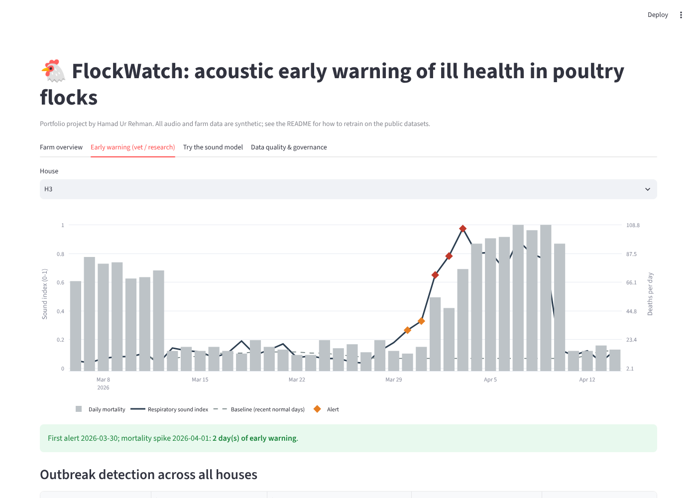
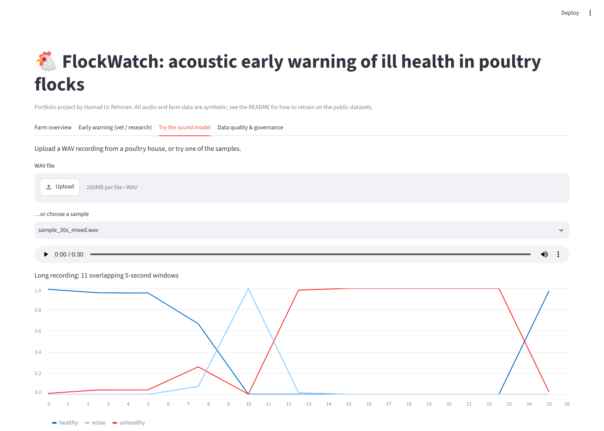
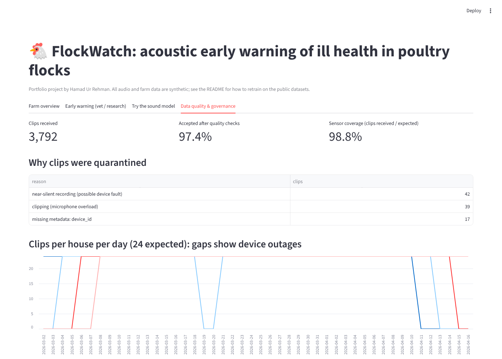

# 🐔 FlockWatch: acoustic early warning of ill health in poultry flocks

**PyTorch · audio ML · data governance · SQLite · Streamlit · FastAPI · Excel/VBA reporting**

FlockWatch listens to poultry houses. A convolutional neural network classifies 5-second microphone clips as **healthy**, **unhealthy** (coughs, sneezes, rales) or **noise**. A daily **respiratory sound index** per house then raises an alert when the flock starts to sound sick, **before mortality rises**. Everything around the model is built too: quality-checked data collection, auditable storage, and reports for farm managers, vets and researchers.

🔗 **Live demo:** _add your Streamlit / Hugging Face link here_



> **Data note.** The pipeline runs end to end on **synthetic** audio and farm records generated by this repo, so it works without private data. The folder layout matches the public **Poultry Vocalization Signal Dataset for Early Disease Detection** (Mendeley Data, CC BY 4.0); see [Train on real recordings](#train-on-real-recordings).

---

## Results

### Sound classifier (held-out test set, split by recording session)
| Metric | Value |
|---|---|
| Accuracy | **93.3%** |
| Macro F1 | **0.93** |
| Unhealthy precision / recall | **98.1% / 85.0%** |
| Noise recall | 100% |

The data was split by recording session, never by individual clip, so the model is always tested on sessions it has never heard. This avoids the leakage that inflates many audio results. Most errors are mild unhealthy clips heard as healthy, which is why flock-level alerts combine many clips per day instead of trusting a single prediction.



### Flock early warning (simulated 40-day crop, 4 houses, one clip per hour)
| House | Situation | First alert | Mortality spike | Early warning |
|---|---|---|---|---|
| H3 | Respiratory outbreak | 30 Mar | 1 Apr | **2 days** |
| H4 | Milder respiratory outbreak | 29 Mar | 30 Mar | **1 day** |
| H1, H2 | Healthy | 1 amber day | none | – |

- **False alerts:** 1 amber day in 78 healthy house-days, and none in the 43 days before either outbreak.
- **Data quality:** 97.4% of 3,792 clips passed the checks. Clipped, silent, duplicate or unlabelled clips were quarantined with a stated reason, never silently dropped.

---

## How it works



1. **Collection and governance** (`ingest.py`): every clip is validated, fingerprinted and stored as *accepted* or *quarantined* with a reason. Each pipeline step is written to an audit log.
2. **Features** (`features.py`): audio is resampled to 16 kHz (the public data is 96 kHz) and converted to a standardised 64-band log-mel spectrogram, implemented in NumPy/SciPy.
3. **Model** (`model.py`, `train.py`):
   - a compact 3-block CNN with SpecAugment-style augmentation;
   - class weights to handle imbalanced data;
   - early stopping on validation macro-F1;
   - a group split by recording session.
4. **Early warning** (`early_warning.py`):
   - Each day's sound index is compared with that house's own recent *normal* days, using the median and MAD (median absolute deviation).
   - Alert days are left out of the baseline, so an outbreak can't hide itself.
   - **Amber** means the index is at least 3 robust SDs above normal and at least 0.20. **Red** additionally needs an index of at least 0.40 *or* water intake down 8% or more, which is an independent signal from the flock record card.
5. **Reporting**: a stakeholder dashboard, a REST API and a weekly Excel report per farm, with an optional VBA macro for formatting.

## Dashboard (one view per stakeholder)
| Farm overview (farm manager) | Early warning (vet / researcher) |
|---|---|
|  |  |
| **Try the sound model** (upload a WAV) | **Data quality & governance** |
|  |  |

---

## Quick start
```bash
git clone https://github.com/hamad470/flockwatch && cd flockwatch
pip install -r requirements.txt
python run_pipeline.py            # synthetic data -> train -> monitor -> alerts -> Excel reports (~6 min on a laptop CPU)
streamlit run app/streamlit_app.py
uvicorn api.main:app --reload     # API docs at http://127.0.0.1:8000/docs
pytest -q                         # 7 tests
```
The trained model, database and sample clips are committed, so the dashboard and API work straight after cloning without retraining.

## Train on real recordings
1. Download the [Poultry Vocalization Signal Dataset for Early Disease Detection](https://doi.org/10.17632/zp4nf2dxbh.1) (CC BY 4.0, 346 WAV files: healthy / unhealthy / noise).
2. Replace `data/raw/` with its `healthy/`, `unhealthy/` and `noise/` folders. Files are resampled automatically.
3. Run `python -m flockwatch.train`. Without session metadata each file is its own group; add a `metadata.csv` with `session_id` for a stricter split.
4. Then run `python run_pipeline.py --skip-train` to regenerate the monitoring results with the new model.

The larger [SmartEars dataset](https://doi.org/10.17632/dy6gtvt4mk.2) (6,000 vet-labelled 5-second clips: healthy / sick / none) can be used the same way by renaming `sick` to `unhealthy` and `none` to `noise`.

## Project structure
```
src/flockwatch/   config · audio_synth · make_dataset · features · model · train · predict
                  storage · ingest · monitoring · early_warning · report_excel
app/              Streamlit dashboard          api/      FastAPI service
excel/            WeeklyReportMacros.bas       tests/    pytest suite
docs/             MODEL_CARD.md · DATA_GOVERNANCE.md
models/           trained CNN, metrics.json, training history
reports/          weekly Excel reports, figures
```

## Data governance (summary)
See [docs/DATA_GOVERNANCE.md](docs/DATA_GOVERNANCE.md). Key points:
- a validation gate on collection, with quarantine and stated reasons;
- SHA-256 lineage, and model versions recorded with every prediction;
- an audit log of every pipeline step;
- role-based access, so each farm sees only its own houses;
- a retention policy;
- handling of the human speech that farm microphones can capture (UK GDPR).

## Limitations and next steps
- **Synthetic data:** results show the method works but are not field validation. The next step is retraining on the public recordings and testing on a real flock.
- **The disease signal is simplified.** Real coughs vary by disease, age and house acoustics.
- **Possible improvements:**
  - pretrained audio embeddings such as PANNs or BEATs;
  - event-level cough detection instead of clip classification;
  - multi-signal alerts adding feed, temperature and ammonia;
  - calibration of probabilities.

## Author
**Hamad Ur Rehman**: MSc Data Science, Liverpool John Moores University · [LinkedIn](https://www.linkedin.com/in/hamad-ur-rehman-064b1b21a) · [GitHub](https://github.com/hamad470)

Licence: MIT. Public datasets referenced remain under their own CC BY 4.0 licences.
